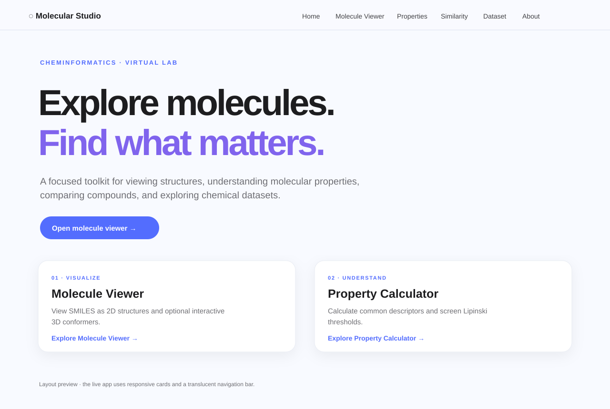

# Molecular Studio
A responsive Copilot-inspired cheminformatics virtual lab built with Streamlit, RDKit, pandas, and Plotly.

## Features
- Home dashboard and page navigation.
- Molecule Viewer: SMILES validation, 2D depiction, optional interactive 3D conformer, canonical SMILES download.
- Property Calculator: MW, LogP, TPSA, HBD/HBA, rotatable bonds, ring count, Lipinski screen, CSV download.
- Similarity Search: Morgan fingerprints, adjustable radius, Tanimoto ranking, chart, CSV export.
- Dataset Explorer: CSV/SDF upload, filtering, chart, filtered download.
- About: calculation notes and data handling.

## Run locally
Python 3.11 is recommended.

```bash
python -m venv .venv
pip install -r requirements.txt
streamlit run app.py
```

## Preview


This SVG is a layout preview, not a captured browser screenshot.

## Design source
The visual direction references the Copilot iOS screens on [Mobbin](https://mobbin.com/apps/copilot-ios-166bc40a-0fb1-47c5-bdd5-6cc642c56f2a/91c57122-173b-52b5-9a0b-6df845b6d1c1/screens). The screen captures were not accessible during implementation; no Mobbin assets are reused.
